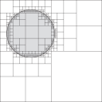
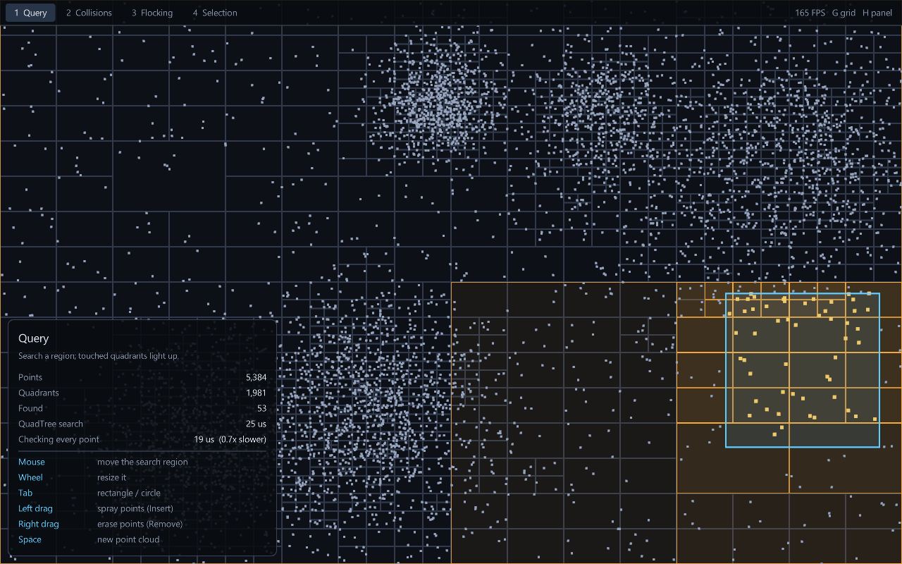

# Auios.QuadTree



[](https://www.nuget.org/packages/Auios.QuadTree/)
[](https://www.nuget.org/packages/Auios.QuadTree/)

A fast, generic QuadTree for .NET 10.

Wikipedia: https://en.wikipedia.org/wiki/Quadtree

## Install

```sh
dotnet add package Auios.QuadTree
```

## Example

```cs
using System.Numerics;
using Auios.QuadTree;

// Implement IQuadTreeObjectBounds<T> for the type you store
public class MyCustomBounds : IQuadTreeObjectBounds<Vector2> {
    public float GetBottom(Vector2 obj) => obj.Y;
    public float GetTop(Vector2 obj) => obj.Y;
    public float GetLeft(Vector2 obj) => obj.X;
    public float GetRight(Vector2 obj) => obj.X;
}

QuadTree<Vector2> quadTree = new(800, 600, new MyCustomBounds());

Random random = new();
List<Vector2> myPositions = [];
for (int i = 0; i < 1000; i++) {
    myPositions.Add(new Vector2(800 * random.NextSingle(), 600 * random.NextSingle()));
}

quadTree.InsertRange(myPositions);

// Search region: x, y, width, height
QuadTreeRect searchArea = new(150, 100, 50, 25);

// Objects whose bounds intersect the search region
Vector2[] positions = quadTree.FindObjects(searchArea);
```

`FindObjects` returns objects whose bounds **intersect** the search rectangle (touching edges count), not every object in overlapping quadrants.

### Searching without allocating

Pass a `List<T>` to reuse it between searches. Results are appended, so clear it first:

```cs
List<Vector2> results = [];

results.Clear();
quadTree.FindObjects(searchArea, results);
```

### Moving objects

Bounds are read once, when an object is inserted. When objects move, either:

* **Rebuild every frame** (best when most objects move): `Clear()` then `Insert` everything again. `Clear()` keeps the tree's storage, so this does not allocate.
* **Update just the movers**: `Remove(obj)` *before* changing its position, then `Insert(obj)` again. `Remove` still works if you forget, but it then has to search the whole tree.

### Tuning

`maxObjects` (default 10) is how many objects a quadrant holds before it splits. `maxLevel` (default 5) caps the depth. With many objects, raise `maxLevel` so quadrants can stay small; the default allows at most 4<sup>5</sup> = 1,024 leaf quadrants.

## Performance

Version 2.0 rewrote the tree for speed:

* Quadrants live in one flat array, and each quadrant keeps its objects in a reusable array, along with the bounds captured at insert. Searches only compare floats; they never call `IQuadTreeObjectBounds<T>` or hash anything.
* A search visits only the quadrants it overlaps, and tests each object's four edges at once with SIMD. When the search region covers a whole quadrant, everything below it is collected without per-object tests.
* `QuadTreeRect` is a struct, `Count()` is O(1), and `Clear()` keeps storage for reuse.

100,000 objects (1–9 units wide) in a 4096 × 4096 world, `maxObjects: 10`, measured with BenchmarkDotNet on a Ryzen 9 3950X (.NET 10). Before = the previous implementation, after = this one.

| Operation | `maxLevel: 5` (default) | `maxLevel: 8` |
| --- | --- | --- |
| Build a new tree | 21.9 ms → 13.9 ms | 58.7 ms → 25.3 ms |
| `Clear()` + insert all again | 22.2 ms → 7.8 ms, 6.3 MB → 0 B allocated | 50.9 ms → 14.3 ms, 13.2 MB → 0 B allocated |
| 1,000 small searches (32 × 32) | 11.1 ms → 1.1 ms (10×) | 137.6 ms → 1.4 ms (99×) |
| 20 large searches (1024 × 1024) | 7.2 ms → 0.9 ms (8×) | 28.6 ms → 1.8 ms (16×) |

Searches using the `List<T>` overload allocate nothing.

Run the benchmarks yourself:

```sh
dotnet run -c Release --project Auios.QuadTree.Benchmarks -- --filter *
```

## Demos

Interactive demos built with [Raylib-cs](https://github.com/raylib-cs/raylib-cs):

```sh
dotnet run -c Release --project Auios.QuadTree.Demos
```

Press **1**–**4** to switch demos, **G** to toggle the quadrant grid, and **H** to hide the info panel. When the mouse leaves the window, the demos keep moving on their own.

| Demo | Shows |
| --- | --- |
| **1 Query** | Clustered points searched by a rectangle or circle that follows the mouse. Quadrants the search touched light up, and the panel compares the search against checking every point. Spray points with `Insert`, erase them with `Remove`. |
| **2 Collisions** | Thousands of bouncing balls. The tree is cleared and rebuilt every frame, and stores ball indices rather than objects. Press **B** to compare against checking every pair. |
| **3 Flocking** | Boids that steer using only the neighbors the tree finds. Hover a boid to see its neighbors. |
| **4 Selection** | Box selection over objects of very different sizes. The tree is built once and kept current with `Remove` + `Insert` as you move or delete units. Press **C** to switch between "touching" and "fully inside". |




`dotnet run -c Release --project Auios.QuadTree.Demos -- --capture <folder>` saves a screenshot of each demo and exits.

## Develop (Cursor / VS Code)

Requires the [.NET 10 SDK](https://dotnet.microsoft.com/download). For Test Explorer in the editor, install **C# Dev Kit** (or the C# extension).

```sh
dotnet test
dotnet pack Auios.QuadTree/Auios.QuadTree.csproj -c Release -o ./artifacts
```

Or run the VS Code / Cursor tasks: **build**, **test**, **pack** (pack runs tests first).
